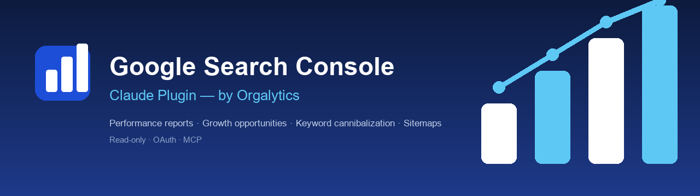
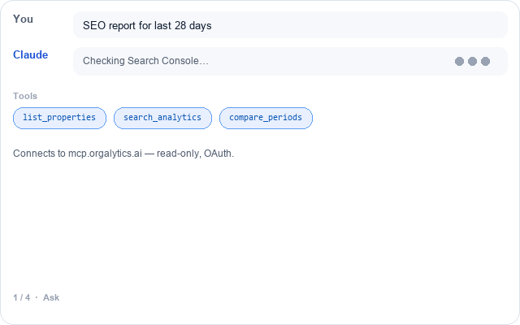
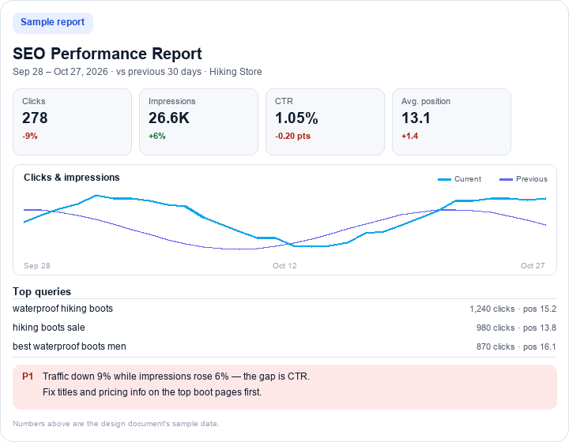
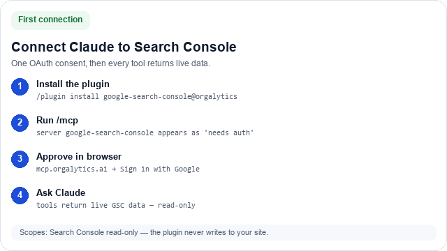

<p align="center">
  
</p>

# Google Search Console MCP: Claude Plugin

<p>
  
  
  
  
</p>

<p align="center">
  
</p>

Connect Claude to the **Google Search Console MCP server** (`https://mcp.orgalytics.ai/mcp`) so you can pull performance reports with previous-period comparison, find growth opportunities near page one, check keyword cannibalization, and review sitemaps and your store's GSC Action Center — right from Claude.

This plugin is a **client**: it only connects to the hosted MCP server. It does not change or redeploy any server code, so nothing in the existing GSC/app flow is affected.

## Quick start

```
/plugin marketplace add pappukushwaha-dev/mcp_orgalytics_ai
/plugin install google-search-console@orgalytics
/google-search-console:report
```

The first command that calls a tool opens the OAuth consent page in your browser. See [First connection](#first-connection).

<p align="center">
  
</p>

## Contents

- [What's inside](#whats-inside)
- [MCP tools exposed by the server](#mcp-tools-exposed-by-the-server)
- [First connection](#first-connection)
- [Skills (model-invoked)](#skills-model-invoked)
- [Commands (slash commands)](#commands-slash-commands)
- [Agent](#agent)
- [Install](#install)
- [Privacy](#privacy)
- [Troubleshooting](#troubleshooting)

## What's inside

```
google-search-console/
├── .claude-plugin/
│   ├── plugin.json              # Plugin manifest
│   └── marketplace.json         # Marketplace entry so it installs via /plugin
├── .mcp.json                    # Connects to https://mcp.orgalytics.ai/mcp (OAuth)
├── icon.png                     # Plugin icon for the directory listing
├── commands/                    # Slash commands (one per workflow)
│   ├── report.md                # /google-search-console:report            -> search_analytics + compare_periods
│   ├── opportunities.md         # /google-search-console:opportunities     -> get_growth_opportunities + get_action_center
│   ├── cannibalization.md       # /google-search-console:cannibalization   -> find_cannibalization
│   └── sitemaps.md              # /google-search-console:sitemaps          -> list_sitemaps
├── agents/
│   └── gsc-auditor.md           # Subagent that drives a full Search Console audit end to end
├── skills/                      # Model-invoked skills (auto-activate from natural language)
│   ├── seo-performance-report/  # Performance report with previous-period comparison
│   ├── growth-opportunities/    # Queries at positions 8-20, ranked by upside
│   ├── keyword-cannibalization-check/  # Queries split across multiple own URLs
│   ├── site-health/             # Connection, store setup, properties and sitemaps
│   └── report-format/           # Canonical answer shape (verdict + P1/P2/P3 + tool citations)
├── hooks/
│   └── hooks.json               # SessionStart connectivity reminder
├── LICENSE                      # MIT
└── README.md
```

## MCP tools exposed by the server

| Tool | Use |
|------|-----|
| `whoami` | Tenant identity: platform, store, domain, scopes. |
| `store_info` | The store's GSC setup: name, connected domains, plan tier, Google token status. |
| `list_properties` | Search Console properties the connected Google account can access. |
| `list_sitemaps` | Submitted sitemaps with last-submitted dates and indexed counts. |
| `search_analytics` | Totals and top rows grouped by query or page, with CTR and position. |
| `compare_periods` | A date window vs the previous window of the same length. |
| `get_growth_opportunities` | Queries at positions 8-20 with real impressions, scored by upside. |
| `find_cannibalization` | Queries split across multiple own URLs, with a suggested owner. |
| `get_action_center` | Insight reports and site health from the Orgalytics dashboard. |

<p align="center">
  
</p>

Numbers in the sample report are design-document sample data, not live metrics.

## First connection

1. After install, run `/mcp` and confirm the `google-search-console` server is listed.
2. The first tool call opens the Orgalytics connect page in your browser.
3. Sign in with Google and approve the Search Console scopes.
4. Return to Claude — the tools now return live data.

<p align="center">
  
</p>

## Skills (model-invoked)

Skills auto-activate from natural language:

- **SEO Performance Report** — totals with previous-period comparison, top queries and pages.
- **Growth Opportunities** — positions 8-20 with upside scoring, plus dashboard alerts.
- **Keyword Cannibalization Check** — queries split across multiple own URLs, with a primary-page recommendation.
- **Site Health** — connection, store setup, properties and sitemap coverage.

## Commands (slash commands)

- `/google-search-console:report [date_range]` — SEO performance report.
- `/google-search-console:opportunities [date_range]` — growth opportunities ranked by impact.
- `/google-search-console:cannibalization [date_range]` — keyword cannibalization check.
- `/google-search-console:sitemaps [date_range]` — sitemap status.

## Agent

**gsc-auditor** — a subagent that drives a full Search Console audit end to end: connection check, performance vs previous period, growth opportunities, cannibalization, sitemaps and one prioritized action plan.

## Privacy

Read-only. The plugin and server read Search Console data for your connected property and never modify your site or your Search Console account. No credentials are stored in the plugin.

## Troubleshooting

- **401 from a tool** — run `/mcp` and complete the OAuth prompt.
- **Empty data** — GSC data lags 1-2 days; pick a window ending at least 2 days ago.
- **Wrong property** — check the connected property in the Orgalytics dashboard, then re-ask.
